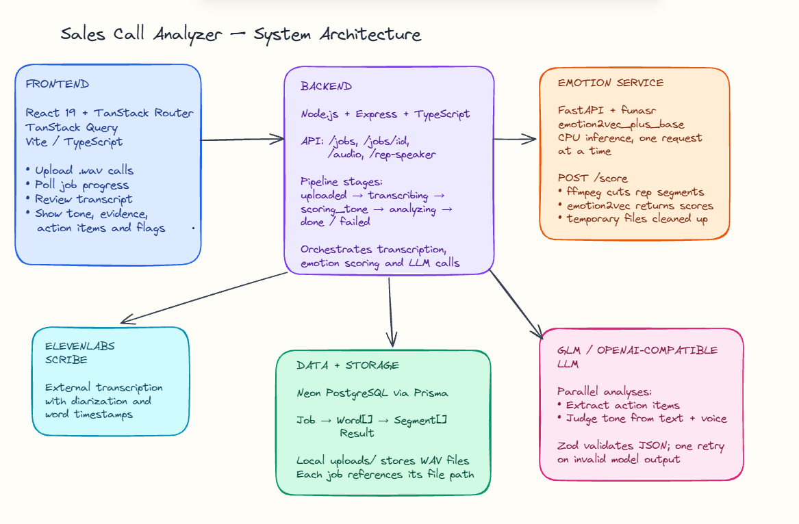

# Sales call analyzer

React frontend  -> Node/Express backend -> private Python emotion service.

## Architecture



## Start the three services

Run these in three separate terminals from this folder:

```powershell
# 1. Emotion service (port 8001, loads emotion2vec once at startup)
.\emo-env\Scripts\python.exe -m uvicorn app:app --app-dir emotion-service --host 127.0.0.1 --port 8001

# 2. Backend (port 4000)
npm run dev --prefix backend

# 3. Frontend (Lovable dev server, usually http://localhost:8080 - check the terminal for the URL)
npm run dev --prefix frontend
```

Check that FFmpeg and FFprobe are installed and available on PATH first: `ffmpeg -version` and `ffprobe -version`. Uploads support WAV, MP3, M4A, MP4, OGG, and OPUS. Corrupt files and files without an audio stream are rejected before analysis starts.

## Setup notes

- Install once with `npm ci --prefix backend` and `npm ci --prefix frontend`. The frontend was already built; these commands just restore its pinned dependencies.
- Copy `backend/.env.example` to `backend/.env` and fill in the values (secrets are never committed). `DATABASE_URL` is the Neon Postgres connection string. Set `MOCK_EXTERNAL=true` to run without ElevenLabs/GLM keys; the emotion service is still called for real.
- Copy `emotion-service/.env.example` to `emotion-service/.env` if you want to override the emotion model id. The service requires ffmpeg on PATH.
- Apply the database schema once with `npm run db:migrate --prefix backend` (this also generates the Prisma client; `npm run db:generate --prefix backend` regenerates it alone).
- The frontend points at `http://localhost:4000` by default; override with `VITE_API_URL` in `frontend/.env`.
